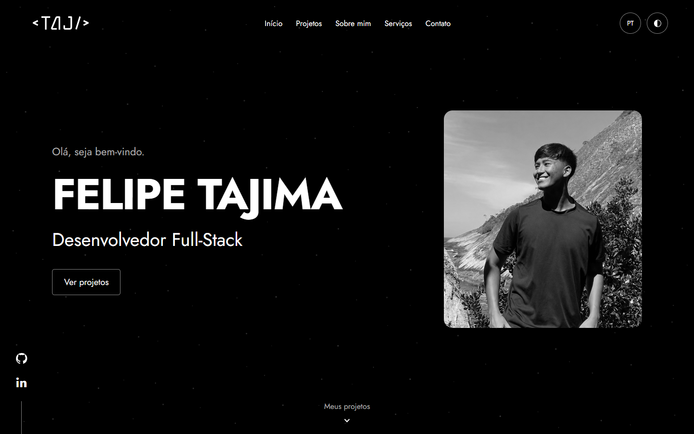

# Fundo de partículas do hero

Status: partículas escolhidas pelo usuário em 2026-10-25, com movimento contínuo solicitado e implementado em 2026-10-26. As capturas abaixo continuam sendo estudos estáticos; o comportamento atual está descrito nesta página e no [ADR-008](../adr/0008-motion-e-particulas.md).

## Estudos atuais

| Tela | Escuro | Claro |
| --- | --- | --- |
| Desktop, nome horizontal | [Ver](photos/mockups/hero-dark-1440-pt.png) | [Ver](photos/mockups/hero-light-1440-pt.png) |
| Celular, 360 px | [Ver](photos/mockups/hero-dark-360-pt.png) | [Ver](photos/mockups/hero-light-360-pt.png) |
| Tablet, 768 px | [Ver](photos/mockups/hero-dark-768-pt.png) | [Ver](photos/mockups/hero-light-768-pt.png) |

O nome completo fica em uma linha no desktop, com a função abaixo e um bloco mais largo junto da imagem lateral. Em telas pequenas, permitir quebra sem reduzir excessivamente a fonte. A foto do costão foi aplicada no espaço lateral, preservando a textura decorativa atrás do conteúdo. A [galeria revisada](photos/mockups/README.md) inclui os dois idiomas; as capturas anteriores desta pasta permanecem como histórico do estudo de fundo.

## Movimento implementado

Os PNGs são apresentações do estudo, não a origem do fundo em execução. Os desenhos vetoriais transparentes possuem três grupos independentes de profundidade:

- [Campo escuro em SVG](hero-backgrounds/particles-field-dark.svg).
- [Campo claro em SVG](hero-backgrounds/particles-field-light.svg).

Os grupos `particles-far`, `particles-mid` e `particles-near` são referenciados dos mesmos SVGs em `public/decoration/`, por três camadas com transforms controlados por Motion (`motion/react-mini`). Texto, fotografia e controles permanecem imóveis; não há máscara vazia ao redor deles nem cópia duplicada do campo de fundo anterior.

Longe/meio/perto têm ciclos de 32/28/24 s, deslocamentos horizontais de 8/12/16 px e verticais de 6/10/12 px, voltando ao ponto inicial sem salto. O ritmo é contínuo e discreto, sem piscar, conectar pontos ou perseguir o ponteiro. Coordenadas e cores foram preservadas; tamanho e opacidade tiveram o refino solicitado pelo proprietário, descrito abaixo.

O botão no canto inferior direito pausa/retoma sem perder a fase, com nome acessível PT/EN e teclado. O movimento também pausa fora do hero ou com a aba inativa. Movimento reduzido, inclusive alterado durante a visita, mantém o campo estático e omite o controle; sem JavaScript, os SVGs permanecem visíveis sem botão inativo. O mesmo movimento funciona em celular, tablet e desktop. Não interfere no conteúdo, nas âncoras ou na futura abertura da marca.

Referências técnicas: [animações CSS](https://developer.mozilla.org/en-US/docs/Web/CSS/Guides/Animations/Using) e [preferência por movimento reduzido](https://developer.mozilla.org/en-US/docs/Web/CSS/@media/prefers-reduced-motion).

## Composição e leitura

- Fundo base continua `#FFFFFF` ou `#000000`; a textura é uma camada decorativa, sem mudar a paleta da página inteira.
- As partículas são pretas no claro e brancas no escuro, com opacidade reduzida conforme os [tokens](tokens.md). A intensidade preserva pontos visíveis no campo inteiro, sem acento cromático, mudança de posições ou recorte junto ao texto.
- Nome, função, boas-vindas, currículo e navegação têm prioridade visual. O campo é contínuo inclusive atrás deles: controlar intensidade no conjunto, sem máscara ou gradiente que apague partículas nessa região. Os próprios caracteres cobrem pontos sob seus traços, não os espaços entre eles.
- A textura pode ser recortada/reduzida no mobile, sem obrigar a reproduzir todos os detalhes do desktop.
- A imagem lateral e o fundo têm papéis distintos: a imagem apresenta o profissional ou sua identidade; a textura acrescenta atmosfera.
- Não escolher fotografia de fundo antes da definição da imagem lateral se isso criar dois focos concorrentes. Uma imagem de textura autoral pode ser estudada depois, caso as opções geométricas não atendam à direção desejada.

## Histórico da exploração

A [comparação inicial](hero-backgrounds/comparison.png) incluía partículas com área vazia, linhas de fluxo e malha. Ela é histórica, não o desenho vigente. O recorte da primeira versão foi retirado conforme o retorno do usuário; linhas e malha não foram escolhidas.

## Validação realizada e limites

O desenho desktop contém 209 pontos distribuídos pelo campo, incluindo a região do nome/função. Na revisão monocromática, a opacidade foi ajustada para preservar a leitura: o menor contraste calculado do texto secundário contra as cores do fundo decorado é de 5,41:1 no escuro e 4,75:1 no claro. Resultados em [refinement-checks.txt](hero-backgrounds/refinement-checks.txt). A checagem usa cores compostas e não substitui a revisão da interface real ou de uma animação.

Capturas foram conferidas nos dois temas e em 360, 768 e 1440 px. Essas amostras não comprovam comportamento em qualquer largura, zoom ou dispositivo. Uma animação exige verificar contraste durante o movimento, ritmo, recorte nas bordas, pausa e preferência reduzida.

O texto continua como texto na implementação futura: não usar o PNG completo do mockup como fundo da aplicação. O SVG de partículas é uma origem vetorial editável, sem exigir um bitmap ou motor 3D.

### Verificação do movimento em 2026-10-26

Tipos, lint, dez testes de conteúdo e build passaram. A suíte completa passou com 123 testes Chromium, dos quais 15 são específicos das partículas. A primeira execução detectou uma falha quando `matchMedia` estava ausente; o fallback foi corrigido e a suíte completa passou na reexecução. Nessa primeira entrega, os SVGs preservavam também os hashes originais; o refino de visibilidade posterior altera somente raios e opacidades dos ativos de execução, mantendo os 209 círculos por tema e suas posições.

Conferidos PT/EN × claro/escuro × 360/768/1440 px, SVGs externos com geometria renderizada, transforms mudando entre quadros e conteúdo imóvel, pausa/retomada por teclado sem sobrepor a indicação de projetos, suspensão ao sair do hero, troca de tema, preferência reduzida alterada durante a visita e fundo estático sem JavaScript. O servidor local em `localhost:3000` também respondeu em PT/EN com as três camadas em movimento, sem erros na página.

A lógica de aba inativa foi verificada com evento de visibilidade simulado em headless. Não foram testados Safari, Firefox, dispositivos físicos, leitores de tela ou consumo de energia/FPS em aparelhos reais. Capturas documentam o layout, enquanto as verificações de transforms e reprodução cobrem movimento e pausa; screenshots isoladas não comprovam fluidez universal.

### Refino de visibilidade

O proprietário pediu pontos maiores ou mais contrastantes após avaliar o movimento. Na primeira revisão, os SVGs de execução receberam raios 1,10/1,70/2,40 (antes 0,65/1,00/1,40) e opacidades multiplicadas por 1,15. Preservados os 209 círculos, coordenadas, grupos e cores por tema. Duração, trajetórias, pausa, movimento reduzido e interação não foram alterados; os SVGs do estudo permanecem intactos. Valores vigentes em [tokens](tokens.md).

Após esse refino, tipos, lint, build, dez testes de conteúdo e os 15 cenários Chromium das partículas passaram. Comparadas capturas anteriores/atuais e conferidos PT/EN, claro/escuro e 360/768/1440 px. Os demais 108 testes de navegador não foram repetidos neste ajuste dos ativos gráficos. O cálculo com um ponto isolado na maior opacidade resulta em contraste de aproximadamente 4,57:1 no claro e 4,75:1 no escuro para o texto secundário; não é uma certificação de todos os pixels durante o movimento ou de eventuais sobreposições de pontos.

Em seguida, o proprietário pediu mais opacidade e pontos mais escuros no tema claro. Após confirmar cinza escuro próximo do preto no tema claro, os valores da primeira revisão foram multiplicados por 6 no claro e por 1,3 no escuro, resultando em aproximadamente 54–76% e 18–33%, respectivamente. A cor-base continua preta/branca conforme o tema. O token `hero-muted` usa #444444/#CCCCCC na saudação e na indicação de projetos para preservar sua hierarquia e leitura; as demais seções continuam com `text-muted`. Raios, distribuição e animação permanecem iguais.

Os textos do hero recebem um contorno de sombra de 1 px na cor do fundo para preservar os caracteres sobre os pontos escuros, sem criar uma área vazia ao redor do bloco de texto. As ações do hero usam a superfície do tema sob seus rótulos.

Na revisão de opacidade/cinza escuro, tipos, lint, build, dez testes de conteúdo e 21 testes Chromium de partículas/interações passaram. Conferidos novamente os dois idiomas, temas e as três larguras, além de teclado, toque, pausa e movimento reduzido. As outras seções não foram reexecutadas; os registros de contraste calculado acima se referem às revisões anteriores, não aos pontos escuros atuais com proteção dos caracteres.

### Correção da prévia e atualização dos recursos

A inspeção da aba do proprietário mostrou pontos claros, apesar dos ativos de execução já conterem cinza escuro. O endereço `localhost:3000` estava servindo outra instância, enquanto o endereço IPv4 explícito `127.0.0.1:3000` servia este repositório; a confirmação visual passou a ser feita nessa prévia. Não foram alterados novamente cor, tamanho ou opacidade nesta correção.

O componente usa imports estáticos do Next.js para gerar URLs dos SVGs com hash do conteúdo. Isso também permite atualizar o recurso após mudanças nos arquivos, em vez de depender do reaproveitamento do mesmo endereço público. Os cenários de PT/EN em desktop no tema claro agora verificam pixels realmente escuros numa amostra de fundo sem texto/foto: a geometria não era suficiente para detectar um recurso antigo ou claro demais.

Validação desta correção: tipos, lint, build, dez testes Node e os 15 cenários Chromium das partículas passaram, incluindo a amostragem de pixels em PT/EN. A própria prévia no navegador da aplicação foi conferida em `http://127.0.0.1:3000/pt`, com tema claro e pontos escuros visíveis. A matriz de capturas cobre os dois temas/idiomas e as três larguras. Não foram repetidos os demais testes de navegador; os SVGs de origem, cores, raios e opacidades ficaram intactos nesta correção de carregamento/prévia.
