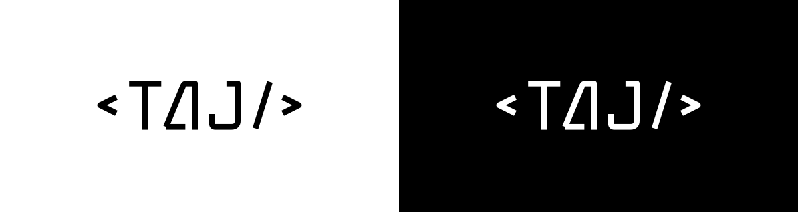

# Lettering TAJ

Status: desenho e espaçamento aprovados pelo usuário em 2026-10-25. A cor foi revisada por solicitação posterior: preto puro no tema claro e branco puro no escuro, em todas as letras e símbolos. Preservar os traçados e o espaçamento do SVG vigente.

Revisão de 2026-10-25 conforme a referência e os ajustes do usuário: traço fino, geometria técnica, base alinhada e cor sólida conforme o tema. O espaçamento geral foi ampliado, com o fechamento `/>` mais próximo entre si. As versões anteriores em azul e com gradiente foram substituídas. A aplicação reutiliza as exportações clara/escura sem alterações, selecionadas pelo tema efetivo via CSS; o header usa 132 px em telas estreitas e 144 px nas demais. A abertura, implementada em 2026-10-26, incorpora o mestre sem alterar seus paths.

[Referência fornecida pelo usuário](lettering/reference-user.png) e [aplicações em escala de header](lettering/lettering-preview.png).

## Arquivos

| Arquivo | Uso |
| --- | --- |
| [SVG mestre](../../public/brand/taj-wordmark.svg) | Marca completa com `stroke="currentColor"`, para uso inline com a cor definida pelo tema ativo. |
| [SVG para tema claro](../../public/brand/taj-wordmark-light.svg) | Traçados aprovados em preto `#000000`, para uso como arquivo de imagem sobre fundo claro. |
| [SVG para tema escuro](../../public/brand/taj-wordmark-dark.svg) | Traçados aprovados em branco `#FFFFFF`, para uso como arquivo de imagem sobre fundo escuro. |

Todos usam `viewBox="0 0 158 44"`, com fundo transparente, sem fontes, imagens incorporadas, scripts ou dependências externas. Letras e símbolos compartilham uma única cor em cada tema.

No uso inline, definir `color` pelo token `logo` do tema ativo, sem herdar por acidente o cinza do texto. Em ``, usar a exportação clara ou escura correspondente: o `currentColor` dentro de um SVG externo não herda a cor da página. A seleção deve acompanhar o tema efetivo do site, inclusive escolha manual e abertura, e não somente a preferência do sistema.

## Construção

- T de barra horizontal e haste fina.
- O refinamento de espaçamento abre mais 3 unidades nos intervalos de `<`, T, A, J e `/`, reduzindo em 6 unidades o intervalo anterior entre `/` e `>`. A revisão de cor preserva esse desenho, alinhamento e traço.
- A técnico, com perna diagonal, haste direita vertical e abertura inferior próxima à referência.
- J de haste reta e curva inferior curta; base visual alinhada com T e A, sem o avanço inferior do desenho rejeitado.
- Traço comum de 3,6 unidades, sem inclinação aplicada ao conjunto; símbolos menores e próximos das letras.
- Cor sólida `#000000` no claro e `#FFFFFF` no escuro, compartilhada por letras e símbolos, sem gradientes. Ícones, foco e detalhes da interface seguem essa mesma inversão; partículas usam a cor correspondente com opacidade reduzida.

Jost permanece nos textos do site; o lettering é composto por paths próprios. Evitar recriar a marca digitando `<TAJ/>` com uma fonte ou aplicar à marca a opacidade decorativa das partículas.

## Aplicação

Propor 144 px de largura no header amplo, 132 px no estreito e mínimo recomendado de 120 px para o conjunto completo. Preservar a proporção, o respiro do desenho e os símbolos; não condensar ou separar manualmente as letras nas aplicações finais.

Os SVGs têm nome acessível. Ao usar como imagem na aplicação, fornecer alternativa textual adequada; se a marca estiver dentro de um link já identificado, evitar anúncio duplicado.

Para a abertura, o mestre separa `syntax-open`, `taj-letters`, `syntax-slash` e `syntax-close`, além das três letras. Motion desloca os símbolos e revela as letras em conjunto, preservando a geometria/espaçamento final. O [storyboard](motion.md) usa os mesmos traçados, sem depender de glifos da fonte.

## Revisão realizada

Os SVGs foram renderizados e inspecionados nos fundos branco/preto e em 120, 132 e 144 px, além da escala ampliada. As exportações mantêm os mesmos paths e dimensões do mestre. Preto sobre branco e branco sobre preto têm contraste opaco de 21:1; a interface completa ainda exige verificação na implementação.
