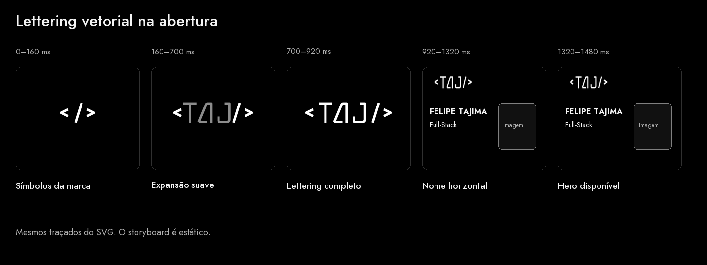

# Storyboard e linguagem de movimento

Revisão de 2026-10-26. A abertura foi implementada com Motion após o proprietário adotar aproximadamente 2,5 segundos e uma vez por sessão da aba. Critérios em [F08](../features/abertura.md), liberação no [ADR-009](../adr/0009-abertura-por-sessao.md) e aparência em [tokens](tokens.md).

As entradas finais das seções foram aprovadas pelo proprietário em 2026-10-26: surgir transparente e de baixo para cima, com transição suave de 900 ms, sem zoom ou recorte. Esse é o resultado visual a preservar na próxima etapa; a aprovação não equivale a validação nos navegadores/dispositivos ainda pendentes.

## Sequência proposta

| Intervalo | Estado |
| --- | --- |
| 0–270 ms | `</>` centralizado sobre branco/preto do tema correto. |
| 270–1180 ms | Grupos externos abrem espaço e revelam `TAJ` com os traçados aprovados, pretos no tema claro e brancos no escuro, como os símbolos. |
| 1180–1550 ms | `<TAJ/>` completo, breve pausa para leitura. |
| 1550–2500 ms | Abertura sai por opacidade e revela a página na posição de entrada; texto/foto do hero se acomodam durante essa saída. Ao terminar, o conteúdo recebe interação, sem nova espera. |

Alvo de 2,5 s desde a ativação e limite independente de 3 s conforme F08. Os intervalos indicam a proporção da sequência: o tempo consumido pela hidratação é descontado proporcionalmente, preservando o primeiro estado. Hidratação a partir de 500 ms libera diretamente a página. Não esperar imagens. O movimento forma a marca de uma vez, sem digitação de letras ou tecnologia rotativa abaixo da função.

O [SVG mestre do lettering](../../public/brand/taj-wordmark.svg) separa letras e símbolos e é incorporado durante a pré-geração para a abertura. O storyboard usa rasterizações desses mesmos paths, sem substituir a marca por glifos Jost.

## Movimento por área

- Hero: texto se acomoda em até 16 px e foto sobe sem escala durante a saída da abertura, com duração de até 750 ms e sem segunda espera. Header recebe opacidade discreta. Sem loop de tecnologias.
- Partículas: direção de fundo escolhida, com [grupos vetoriais separados](hero-backgrounds.md#animação-posterior). É possível animar camadas depois, sem animar nome/função nem apagar o campo ao redor deles. O movimento contínuo foi solicitado e implementado em 2026-10-26 com três camadas, pausa manual e suspensão por visibilidade; ver ADR-008.
- Projetos: título com deslocamento curto e previews com entrada vertical, sem escala ou recorte, uma vez quando visíveis. O slide permanece nativo por botão, teclado, toque ou arrasto, sem autoplay, transformações dos itens ou bloqueio vertical.
- Serviços: título e cards com entrada individual ao alcançarem a tela. O menu não consome os efeitos dos cards ainda fora da área visível. Movimento não oculta conteúdo.
- Sobre mim: texto com acomodação de até 24 px, foto com entrada vertical e tecnologias com opacidade discreta; nada depende do efeito para aparecer.
- Fotos pessoais e imagens de projetos: cores originais por padrão; aplicar preto e branco na própria imagem em hover compatível, com transição CSS de 350 ms. No celular/toque e sem hover, manter coloridas; com movimento reduzido, troca imediata. Não condicionar textos ou ações dos projetos ao efeito. [Regras completas e exemplo CSS](photos/README.md#preto-e-branco-e-interação). Este efeito não depende da biblioteca Motion escolhida.
- Contatos: entrada curta do conjunto de canais e opacidade do texto; rodapé com opacidade discreta. Foco/clique encerra o efeito local imediatamente; hovers continuam em CSS. Nenhum estado de “enviando mensagem”.
- Tema: transição curta de cor, se útil; não animar todas as propriedades.

Curvas iniciais: `cubic-bezier(0.22, 1, 0.36, 1)` para acomodação e `cubic-bezier(0.2, 0, 0, 1)` para estado. Resposta curta: 140 ms; menu: até 220 ms.

Após o proprietário relatar entradas pouco perceptíveis, as entradas passaram a 900 ms, com deslocamento de até 24 px e curva `cubic-bezier(.25, .1, .25, 1)`, usando a mesma dependência `motion/react-mini`. Acontecem uma vez por montagem. Por pedido explícito do proprietário, blocos e imagens partem transparentes (opacidade zero) e sobem até a posição final, sem zoom. O primeiro estado é preparado fora da tela, com disparo 24 px dentro da borda inferior da tela para que o surgimento seja percebido. Conteúdo já visível/restaurado fica estático; movimento reduzido e foco mantêm a leitura imediata. Âncoras não desativam toda a seção. Detalhes em [ADR-010](../adr/0010-movimento-das-secoes.md) e [verificação](../movimento-verificacao.md).

## Refino de hover implementado

Em 2026-10-26, o proprietário pediu feedback mais perceptível. O refino usa somente CSS: inversão preto/branco nos botões e controles, fundo preenchido na navegação/menus e inversão dos círculos de contato. Ações têm elevação curta; setas e o ícone de acesso externo respondem na direção da ação. A indicação do hero desloca apenas a seta, mantendo seu posicionamento central. Transições duram 180 ms com a curva de estado.

Os efeitos de hover exigem `(hover: hover) and (pointer: fine)`. Foco por teclado usa o mesmo contraste e mantém o anel visível; pressionamento tem escala discreta. Controles desabilitados não recebem os efeitos. Com movimento reduzido, troca de cores imediata e sem deslocamentos/escala. A transição de cor das fotos segue a regra já aprovada. Conteúdo sem ação, como os serviços, não ganhou links nem cursor de botão. Esse refino continua em CSS mesmo após a escolha de Motion.

## Movimento reduzido e falhas

Ir diretamente ao hero com `prefers-reduced-motion`, mantendo a marca estática no header. Troca de slide deve funcionar sem deslocamento animado. Foco e informações continuam disponíveis sem efeitos.

Falhas de JavaScript, fontes ou animação não mantêm a página escondida. Rolagem nativa, sem scroll hijacking. Revisar entrada por âncora, cancelamento, repetição por sessão e liberação de foco/rolagem na implementação, não apenas nas capturas.

## Biblioteca

Motion foi escolhido pelo proprietário em 2026-10-26 e registrado no [ADR-008](../adr/0008-motion-e-particulas.md). `motion@14.6.0` usa `motion/react-mini` nas partículas e `motion/react` na sequência da abertura. Execução em [ADR-009](../adr/0009-abertura-por-sessao.md).

### Comparação que fundamentou a escolha

Consulta às fontes oficiais em 2026-10-26. A recomendação por Motion foi aceita pelo proprietário após a comparação abaixo; o ADR-008 registra a decisão e a implementação atual. A abertura curta precisa coordenar grupos do SVG e sua saída; hover CSS e slide nativo permanecem independentes.

| Opção | Capacidades documentadas | Avaliação para este portfólio |
| --- | --- | --- |
| Motion para React (`motion`, imports `motion/react`) | [Suporte ao Next.js App Router e React 18.2+](https://motion.dev/docs/react-installation), [sequências com escopo e limpeza no componente](https://motion.dev/docs/react-use-animate), [hook de movimento reduzido](https://motion.dev/docs/react-use-reduced-motion), [licença MIT](https://github.com/motiondivision/motion/blob/main/LICENSE.md). | Recomendação: atende à coordenação da marca e do hero com uma fronteira de cliente pequena. Não exige converter as seções de conteúdo em componentes de cliente. |
| GSAP | [Timelines com controle de ordem e sobreposição](https://gsap.com/docs/v3/GSAP/Timeline/), [integração React com `useGSAP` e limpeza](https://gsap.com/resources/React/). | Alternativa se a direção evoluir para coreografias extensas em SVG e várias timelines. Sua capacidade adicional não é uma necessidade demonstrada na abertura atual. |
| CSS + Web Animations API, sem biblioteca | [API nativa com keyframes e controle de reprodução/cancelamento](https://developer.mozilla.org/en-US/docs/Web/API/Web_Animations_API/Using_the_Web_Animations_API). | Viável para manter zero dependências novas; coordenação, limpeza e adaptação ao React ficam a cargo do código local. Continua suficiente se o movimento ficar limitado a essa sequência. |

A preferência por Motion é uma avaliação do escopo, não uma medição comparativa de desempenho. A abertura está implementada; não há medição isolada de bundle. A versão estável e os peers foram conferidos na instalação de 14.6.0, conforme ADR-008; repetir a conferência em atualizações futuras.

Para a abertura, usar apenas seus recursos necessários em uma fronteira de cliente para a abertura, preservando os Server Components. Movimento reduzido deve omitir a sequência inteira conforme F08, não apenas reduzir transformações. Uma biblioteca não resolve por si só limite de duração, foco, âncoras, repetição e falhas: esses continuam critérios da implementação.

A escolha da biblioteca está no ADR-008; a duração e a política adotadas pelo proprietário estão em F08 e no ADR-009.
