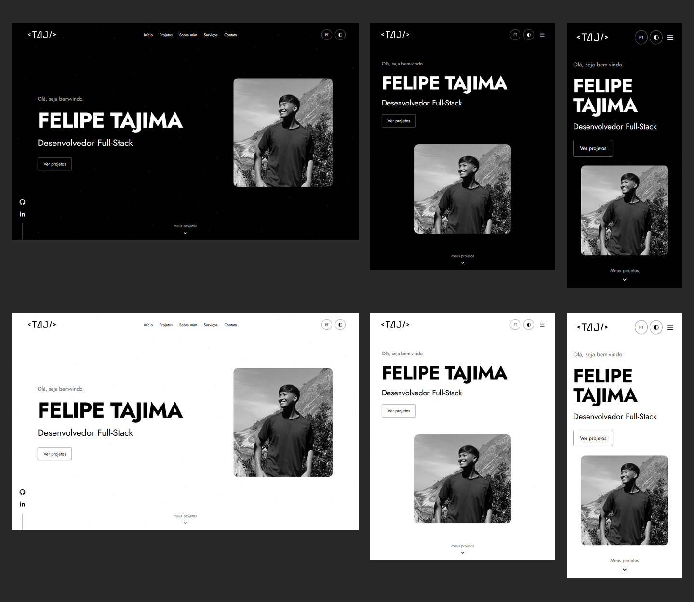
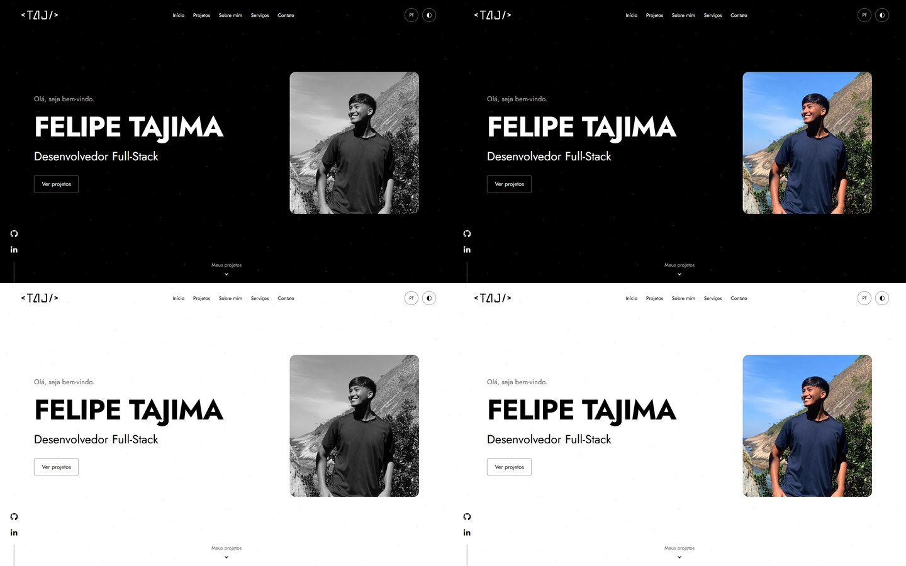

# Mockups com conteúdo definido

Revisão de 2026-10-25 com o [conteúdo editorial vigente](../../../conteudo.md). Hero com a foto do costão e Sobre mim com a foto na floresta, conforme a [seleção e o tratamento aprovados](../README.md). Fotos pessoais e imagens de projetos ficam em preto e branco em todas as telas; cor aparece somente no hover compatível. PNGs renderizados de HTML/CSS de estudo em Chromium local, sem implementação da aplicação Next.js.

> Histórico visual: em 2026-10-30 o proprietário inverteu o efeito na aplicação. Agora as imagens iniciam coloridas, ficam em preto e branco no hover compatível e permanecem coloridas no celular/toque. Os PNGs e resultados abaixo preservam o estudo original; consulte as [regras atuais](../README.md#preto-e-branco-e-interação).

## Conteúdo aplicado

- DevControle, Fast Motors e Today Movies, nessa ordem, com textos PT/EN e imagens fornecidas no outro chat. [Catálogo editorial](../../projects/catalog.json).
- Biografia provisória e dez tecnologias, incluindo Firebase e sem HTML/CSS básicos na lista pessoal.
- Seis serviços: sites institucionais, lojas virtuais, sistemas/dashboards, landing pages, redesign/modernização e manutenção/evolução.
- “Ver projetos” / “View projects” no hero; nenhuma ação de currículo.
- Cinco canais de contato com nomes e ícones, sem URLs, e-mail ou número fictício.

## Comparação do hover

Capturas de Sobre mim com hover: [tema escuro](hover-about-dark.png) e [tema claro](hover-about-light.png). Comparação dos projetos: [padrão à esquerda e hover à direita](project-hover-comparison.png), nos dois temas; capturas completas de hover em [escuro](hover-projects-dark.png) e [claro](hover-projects-light.png). Sem hover, as cinco imagens permanecem em preto e branco, sem alternância por toque.

## Português

| Tela | Hero escuro | Hero claro | Sobre mim escuro | Sobre mim claro | Página escura | Página clara |
| --- | --- | --- | --- | --- | --- | --- |
| Desktop, 1440 × 900 | [Ver](hero-dark-1440-pt.png) | [Ver](hero-light-1440-pt.png) | [Ver](about-dark-1440-pt.png) | [Ver](about-light-1440-pt.png) | [Ver](page-dark-1440-pt.png) | [Ver](page-light-1440-pt.png) |
| Tablet, 768 × 1024 | [Ver](hero-dark-768-pt.png) | [Ver](hero-light-768-pt.png) | [Ver](about-dark-768-pt.png) | [Ver](about-light-768-pt.png) | [Ver](page-dark-768-pt.png) | [Ver](page-light-768-pt.png) |
| Celular, 360 × 800 | [Ver](hero-dark-360-pt.png) | [Ver](hero-light-360-pt.png) | [Ver](about-dark-360-pt.png) | [Ver](about-light-360-pt.png) | [Ver](page-dark-360-pt.png) | [Ver](page-light-360-pt.png) |

## Inglês

| Tela | Hero escuro | Hero claro | Sobre mim escuro | Sobre mim claro | Página escura | Página clara |
| --- | --- | --- | --- | --- | --- | --- |
| Desktop | [Ver](hero-dark-1440-en.png) | [Ver](hero-light-1440-en.png) | [Ver](about-dark-1440-en.png) | [Ver](about-light-1440-en.png) | [Ver](page-dark-1440-en.png) | [Ver](page-light-1440-en.png) |
| Tablet | [Ver](hero-dark-768-en.png) | [Ver](hero-light-768-en.png) | [Ver](about-dark-768-en.png) | [Ver](about-light-768-en.png) | [Ver](page-dark-768-en.png) | [Ver](page-light-768-en.png) |
| Celular | [Ver](hero-dark-360-en.png) | [Ver](hero-light-360-en.png) | [Ver](about-dark-360-en.png) | [Ver](about-light-360-en.png) | [Ver](page-dark-360-en.png) | [Ver](page-light-360-en.png) |

## Seções para revisão

| Seção | Desktop escuro PT | Desktop claro PT | Celular escuro PT | Celular claro PT |
| --- | --- | --- | --- | --- |
| Projetos, posição inicial | [Ver](projects-dark-1440-pt.png) | [Ver](projects-light-1440-pt.png) | [Ver](projects-dark-360-pt.png) | [Ver](projects-light-360-pt.png) |
| Projetos, posição final | [Ver](projects-end-dark-1440-pt.png) | [Ver](projects-end-light-1440-pt.png) | [Ver](projects-end-dark-360-pt.png) | [Ver](projects-end-light-360-pt.png) |
| Seis serviços | [Ver](services-dark-1440-pt.png) | [Ver](services-light-1440-pt.png) | [Ver](services-dark-360-pt.png) | [Ver](services-light-360-pt.png) |
| Contato sem destinos | [Ver](contact-dark-1440-pt.png) | [Ver](contact-light-1440-pt.png) | [Ver](contact-dark-360-pt.png) | [Ver](contact-light-360-pt.png) |

As mesmas seções estão exportadas em 768 px e em inglês, seguindo os nomes `projects-`, `projects-end-`, `services-` e `contact-`, mais tema, largura e idioma. Exemplos em inglês: [serviços no tablet claro](services-light-768-en.png), [serviços no celular escuro](services-dark-360-en.png) e [Today Movies no celular claro](projects-end-light-360-en.png).

## Composição e enquadramento

- Desktop: texto à esquerda, nome em uma linha, função abaixo e foto à direita. Foto do hero em aproximadamente 411 × 452 px, com cintura visível e menos céu.
- Tablet: texto acima e foto centralizada em 400 × 370 px. O ponto focal difere do desktop para preservar cabelo e rosto no quadro mais largo.
- Celular: nome em duas linhas e foto em 272 × 280 px. A altura do hero pode crescer além dos 800 px para manter conteúdo, foto e indicação de projetos sem sobreposição.
- Sobre mim: foto de aproximadamente 489 × 470 px no desktop, 500 × 435 px no tablet e 280 × 300 px no celular; texto e foto ficam empilhados quando necessário.
- Enquadramento feito no contêiner com `object-fit: cover`, posição focal e escala, sem editar os arquivos. Dessaturação reversível em CSS, sem correção de iluminação, espelhamento ou remoção de fundo. Regras de hover e movimento reduzido estão na [especificação das fotografias](../README.md#preto-e-branco-e-interação).
- Mantidos Jost, traçados e espaçamento do SVG aprovado, fundo preto/branco e partículas contínuas. A logo é preta no tema claro e branca no escuro, no header e no rodapé. Projetos seguem primeiro após o hero, em slide aberto; serviços usam cards.
- Detalhes da interface seguem a logo: ícones, contornos de destaque, indicadores e foco pretos no claro e brancos no escuro. Partículas usam a mesma inversão com transparência. Fotos pessoais e mídias dos projetos usam o mesmo efeito CSS: preto e branco inicialmente e cores originais no hover da imagem. Arquivos de origem preservados.
- Projetos mantêm proporção comum no preview e títulos alinhados; as ações ficam na base dos itens. A posição final do estudo mostra Today Movies sem duplicar itens.
- Serviços usam três colunas no desktop, duas no tablet e uma no celular, com títulos longos e descrições completos nos dois idiomas. Os acessos a contato e projetos usam âncoras internas, sem envio de mensagens.

## Verificação e limites

As 12 combinações de tamanho, tema e idioma foram renderizadas sem transbordamento horizontal da página. O nome permanece em uma linha nas quatro amostras de desktop. As fotografias foram conferidas visualmente, com ajuste do recorte para preservar cabelo e rosto. Os hashes SHA-256 confirmam que os dois arquivos de foto permanecem intactos; medidas e resultados em [checks.json](checks.json).

No estudo HTML/CSS, foi verificado o estado padrão dessaturado nas cinco imagens de cada variante, a revelação de cor e o retorno ao preto e branco com mouse, a permanência em preto e branco após toque nas simulações de tablet/celular, a transição declarada de 350 ms e sua remoção com movimento reduzido. Conferidos individualmente hero, Sobre mim, DevControle, Fast Motors e Today Movies. Não foram adicionadas paradas de teclado ou ações para revelar cor.

Na revisão monocromática, também foram conferidas as cores computadas dos ícones, contornos e indicadores, a ausência de cores cromáticas declaradas no CSS do estudo e o foco visível por teclado no desktop. Esses resultados estão no mesmo relatório; não substituem a validação da aplicação futura.

Na revisão editorial, as 12 variantes contêm os três projetos na ordem prevista, seis serviços, dez tecnologias e cinco canais sem destinos. Conferidos: presença de Firebase, ausência de ação de currículo e de textos genéricos antigos, acesso do hero à seção de projetos, carregamento de todas as imagens, altura comum dos previews, alinhamento dos títulos e ausência de sobreposição entre título, descrição e ação nos serviços. As cinco mídias de origem permaneceram intactas; hashes das imagens dos projetos também constam no relatório.

Os PNGs são estáticos e as checagens pertencem ao estudo HTML/CSS: não comprovam menu, troca de tema/idioma, slide interativo, movimento ou acessibilidade da futura aplicação. As duas posições do slide são estados estáticos de composição. Não há aplicação nem scripts de lint, tipos, testes ou build para executar nesta etapa.

As demonstrações dos projetos ainda têm disponibilidade não verificada: o estudo exibe sua posição visual como texto, sem link ativo. Repositórios usam os endereços fornecidos. A contribuição pessoal específica deve ser esclarecida antes da publicação quando ainda desconhecida. Biografia e tecnologias permanecem provisórias, contato aguarda destinos e currículo está ausente por decisão atual.

Os PNGs são artefatos de revisão, não imagens a serem usadas como páginas ou fundos da aplicação. Os estudos anteriores de fundo e o storyboard permanecem como histórico ou esquema de movimento.
